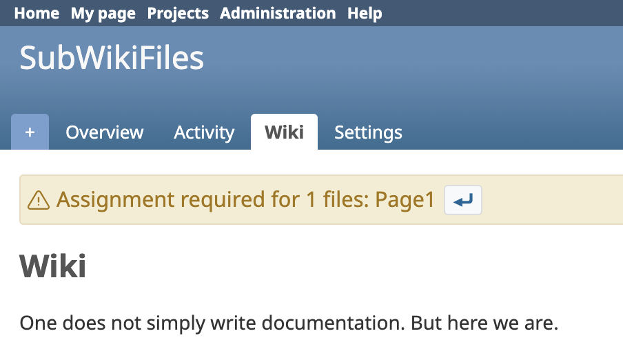
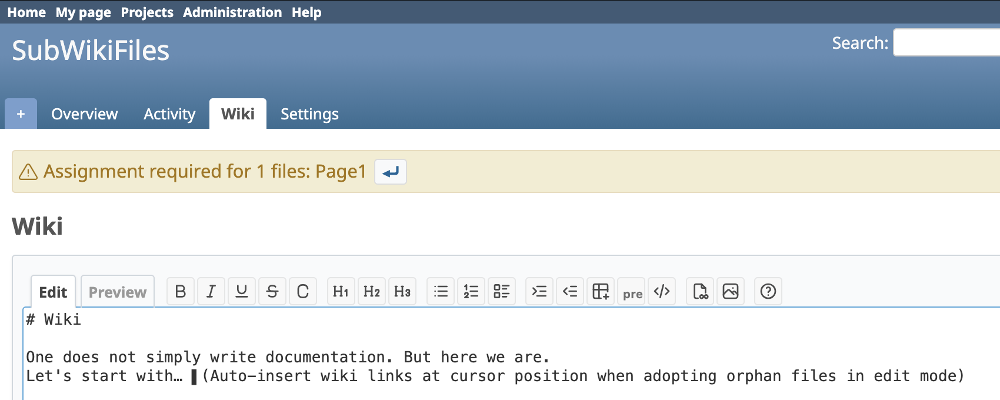
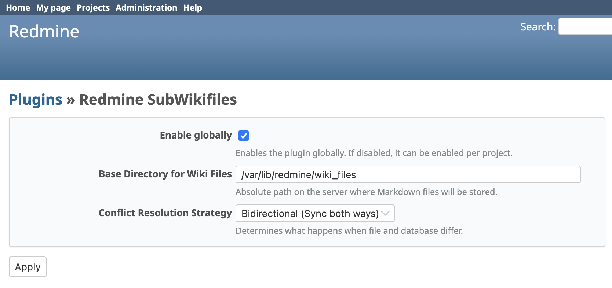

# Redmine Subwikifiles Plugin


A Redmine plugin that synchronises wiki pages bidirectionally with local Markdown files. Edit documentation in any editor you like — the plugin handles hierarchy, detects new folders and orphan files, versions changes automatically via Git, and offers a HedgeDoc-style live split preview in the wiki editor.

> Built for teams that refuse to be locked into any platform. Your docs stay in your filesystem, in plain Markdown, forever.

## Screenshots





## Features

- **Three-way bidirectional sync**: compares the wiki page, the Markdown file, and the last Git `HEAD` commit as common base. Unambiguous changes (`file → wiki`, `wiki → file`, missing files, new files with frontmatter) are synced automatically in the background (throttled to once per 60 s per project tree).
- **Sync status chip & 4-scope popover**: a theme-agnostic status chip in the wiki contextual bar shows the current sync state and opens a popover across four scopes (`Page` · `Branch` · `Wiki` · `+ Subprojects`) with change counters, dry-run previews, and inline decisions for conflicts.
- **Safe deletion handling**: deleting a wiki page in Redmine never deletes the Markdown file on disk automatically, and deleting a file (or whole folder) on disk never deletes the wiki page automatically. Instead, deletion candidates appear in a dedicated **"Delete?"** section in the popover (default: *Skip*, with per-item or bulk confirmation).
- **HedgeDoc-style live split preview**: adds a **Split** tab (`Edit | Split | Preview`) to the wiki editor showing the Markdown editor on the left and a live-rendered Redmine preview (including macros like `{{child_pages}}`, `{{toc}}`, wiki links, and attachments) on the right, with a draggable divider and synchronized scrolling.
- **Hierarchical structure**: projects and subprojects map to folders and subfolders on disk via `.project` metadata; wiki page hierarchy is stored in YAML frontmatter (`parent: ...`).
- **Git integration**: automatically commits changes to a per-project Git repository in the storage directory.
- **Folder detection & project inheritance**: detects new folders and offers native Redmine buttons to create projects/subprojects (inheriting members, roles, enabled modules, and visibility) or move them to `_orphaned`.
- **Orphan file & attachment handling**: detects Markdown files without frontmatter and non-Markdown attachments, offering one-click import/attachment in the notice bar or the sync popover.

## Requirements

- Redmine 4.x, 5.x, 6.x, or 7.x
- A writable directory on the server for file storage
- Git installed on the server (used for per-project versioning and 3-way sync state)

## Installation

> [!IMPORTANT]
> The plugin directory **MUST** be named `redmine_subwikifiles`.

1. **Clone** into your plugins directory:
   ```bash
   cd /path/to/redmine/plugins
   git clone https://github.com/subversive-tools/redmine_subwikifiles.git redmine_subwikifiles
   ```

2. **Run the plugin database migration** (creates the `subwikifiles_known_files` registry so whole-folder deletions are recognized properly):
   ```bash
   cd /path/to/redmine
   bundle exec rake redmine:plugins:migrate RAILS_ENV=production
   ```

3. **Restart Redmine**.

4. **Configure** the plugin under **Administration > Plugins > Subwikifiles > Configure**.

## Configuration

Navigate to **Administration > Plugins > Subwikifiles > Configure**.

| Option | Description | Default |
|:---|:---|:---|
| **Enable globally** | Enable globally for all projects (if disabled, can be enabled per project via project modules) | Disabled |
| **Base Directory for Wiki Files** | Absolute path on the server where Markdown files are stored | `/var/lib/redmine/wiki_files` |
| **Conflict Resolution Strategy** | Preselected default when file and database differ (`file_wins`, `db_wins`, or `manual`) | `file_wins` |
| **Live split preview in wiki editor** | Adds the `Split` tab with side-by-side live preview to the wiki editor | Enabled |

> [!WARNING]
> **Filesystem permissions**: Redmine's role-based permissions are **not** propagated to the filesystem. Access to files on disk is governed solely by the OS user running Redmine.

## Directory Structure

Files are stored under `{base_path}/{Project Name}/`. Subprojects map to subdirectories, and wiki pages live as `.md` files with YAML frontmatter inside their project's folder:

```text
Project Name/
├── .git/
├── .project
├── Wiki.md
├── Parent_Page.md
├── Child_Page.md          # YAML frontmatter: parent: Parent_Page
├── _attachments/
│   └── Page_Title/
│       └── image.png
├── _orphaned/
└── Subproject Name/
    ├── .git/
    ├── .project
    └── Wiki.md
```

## Documentation

- [CHANGELOG.md](CHANGELOG.md) — Version history and release notes
- [doc/TECHNICAL_DOCUMENTATION.md](doc/TECHNICAL_DOCUMENTATION.md) — Architecture, data flow, 3-way sync, and developer guide
- [doc/OPEN_ISSUES.md](doc/OPEN_ISSUES.md) — Open questions and test checklists for experimental features

## Contributing

Contributions are welcome — please fork the repository and open a Pull Request.

1. Fork it
2. Create your feature branch (`git checkout -b feature/my-feature`)
3. Commit your changes
4. Push to the branch
5. Open a Pull Request

## License

[MIT License](LICENSE) — Copyright (c) 2026 Stefan Mischke
